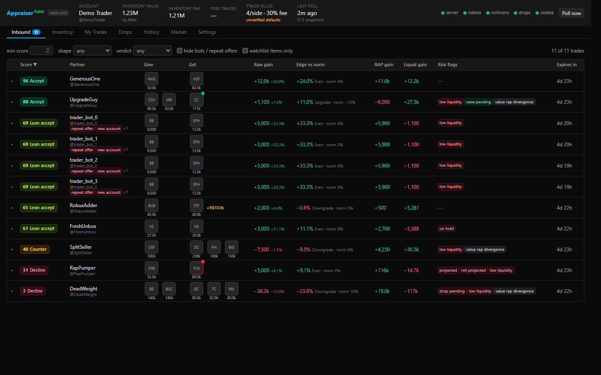
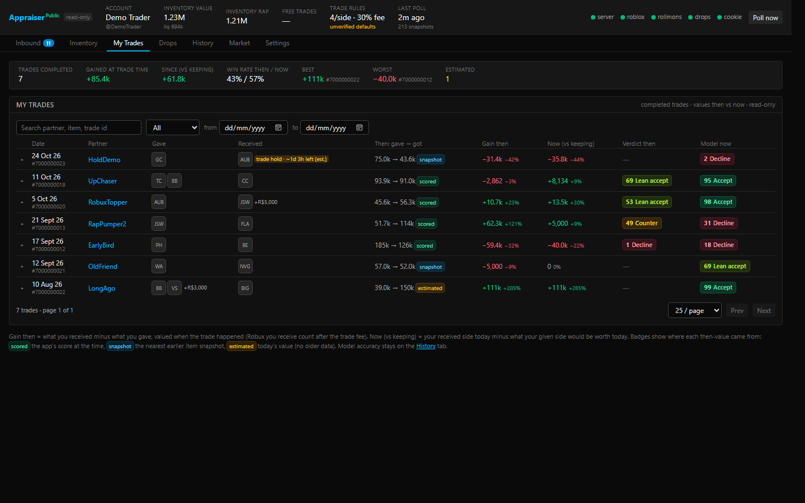
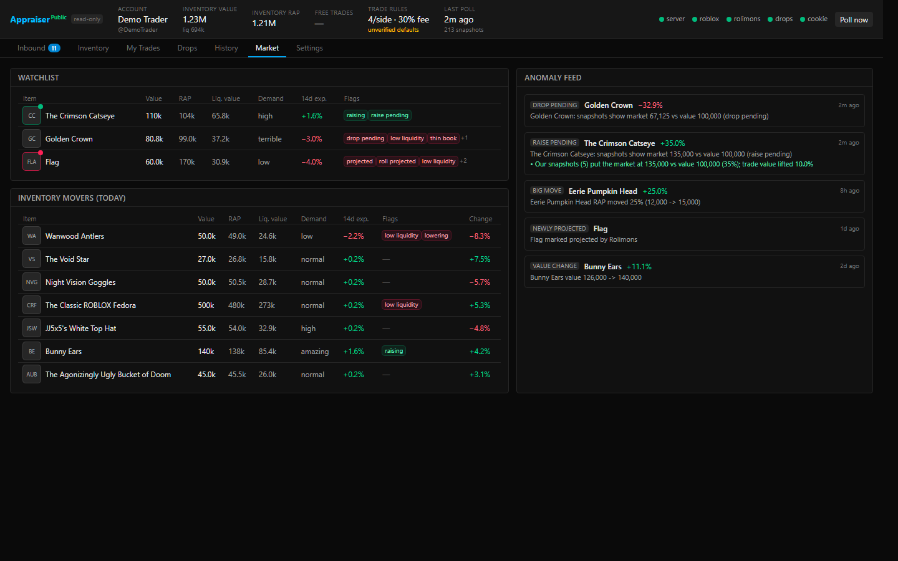

# The Appraiser: A Roblox trading tool

A local, read-only advisor for Roblox limited-item trades on Windows. It watches your inbound trades, values every item, scores each offer from 0 to 100 and sends a desktop notification when an inbound trade scores well. A dark dashboard runs at `http://127.0.0.1:47615`.

**It never acts on a trade.** The code has no accept, decline, counter or send endpoints, and nothing automatic or bulk ever touches a trade. Counter suggestions are text only. You make every trade decision yourself on roblox.com/trades. A guard test (`src/core/no-trade-actions.test.ts`) fails the build if a trade-action or purchase endpoint ever appears in the source.

## Licence & use

You may **not** modify and redistribute it, republish it, build derivative works or projects from it, or use it commercially without written permission from the copyright holder. See [LICENSE](LICENSE) for the full terms and [AI_POLICY.md](AI_POLICY.md) for how this applies to automated tools.

## In short

- Someone sends you a trade → The Appraiser gives it a score out of 100 and a verdict: **Accept**, **Lean accept**, **Counter** or **Decline**, with the reasons.
- Good offers pop up as a Windows notification.
- It also shows your inventory's value, your past trades' profit/loss, and newly released limiteds.
- It only *reads*. You still accept or decline on roblox.com yourself.

## Screenshots

*Demo mode — all names and trades are made up.*

**Inbound trades:** every offer scored and explained.


**My Trades:** what each past trade gained you, then and now.


**Market:** watchlist, inventory movers and value-change alerts.


## Quick start

You need **Windows 10/11** and **[Node.js 22 or newer](https://nodejs.org/)**.

```powershell
npm install
npm run real
```

Your browser opens the dashboard. Go to **Settings**, paste your `.ROBLOSECURITY` cookie, press **Save** — done. Next time just double-click `scripts\start.cmd`.

Want to look around first without a cookie? Run `npm run build`, then `$env:DEMO=1; npm start` (made-up data, no network).

---

<details>
<summary><b>Install</b> (Windows, Node, starting, stopping, background service, updating)</summary>

### Requirements

- Windows 10 or 11
- Node.js 22 or newer, with npm (`node -v` to check)

### Install

From a terminal in the project folder:

```powershell
npm install
npm run build
```

### Starting

- **Easiest:** double-click `scripts\start.cmd`, or run `npm run real`. It builds if needed, starts the app (or reuses one that is already running) and opens the dashboard.
- **Desktop shortcut:** `npm run shortcut` puts an "Appraiser" shortcut on your Desktop that does the same.
- **Plain:** `npm start` runs the built server on `http://127.0.0.1:47615`.

### Stopping

Press **Ctrl+C** in the window it is running in (or close that window). If you installed the background service, see below.

### Run in the background at logon (optional)

```powershell
npm run build
npm run service:install
```

This creates a per-user Task Scheduler task called `Appraiser` that starts 30 s after you log on, runs hidden, restarts if it crashes and runs as you (not SYSTEM), so it can use your Windows credential store and show notifications. It also adds an `Appraiser.url` shortcut to your Desktop.

- Stop it: Task Scheduler → `Appraiser` → End (or log off).
- Remove it: `npm run service:uninstall`.
- Changed the port? Run `npm run service:install` again.

### Updating

Replace the project files with the new version (keep your data — it lives in `%APPDATA%\the-appraiser`, not in the project folder), then:

```powershell
npm install
npm run build
```

`npm run real` / `start.cmd` also rebuilds automatically when the source is newer than the build. If the background service is running, restart it (or log off and on).

</details>

<details>
<summary><b>First run & adding your cookie</b> (and how it is kept safe)</summary>

1. Open the dashboard and go to **Settings → .ROBLOSECURITY cookie**.
2. Paste your cookie value and save. It goes only to the local server on `127.0.0.1`.
3. The app checks whether your account can trade, then loads your inventory and inbound trades. The first full load takes a few minutes because it stays inside Roblox's rate limits.

How the cookie is handled:

- Stored in the Windows Credential Manager or, failing that, in a DPAPI-encrypted file in the data folder. Never written in plain text, never logged (log lines are redacted), and the API only ever returns a masked version.
- Only ever sent to `https://*.roblox.com`. Redirects are refused, so it cannot be forwarded elsewhere.
- If Roblox rotates the cookie, the new one is saved automatically.

**Same-machine caveat:** DPAPI and the credential store protect the cookie from other Windows users and from copies of the file. They do **not** protect it from malware running as your own user — anything running under your account can decrypt it, just as it could read your browser's cookies. Only use this on a PC you trust. To revoke access at any time, log out of all sessions on roblox.com.

If your account cannot trade (for example no Roblox Plus / Premium), the app shows a banner and keeps working as a read-only value viewer.

</details>

<details>
<summary><b>Using the app</b> (what each tab is for)</summary>

- **Inbound** — every open trade someone sent you, with its score, verdict, a plain breakdown of why, risk flags, and counter ideas (text only). The tab badge counts new offers. Click a trade for the full detail.
- **Inventory** — your limiteds with value, RAP, what they would sell for (liquidation value), and a countdown for copies that are still on trade hold.
- **My Trades** — your completed trades: value at the time, value now, and profit/loss.
- **History** — offers you already decided on, the score they had, and how well the model's scores have matched what you did.
- **Drops** — newly released limiteds as they appear. Links open the roblox.com page; you buy there yourself.
- **Market** — your watchlist, unusual price moves, and the biggest movers in your inventory.
- **Settings** — your cookie, goal, notifications, item lists and every tuning knob (see the Settings section).

Verdicts use these default score bands: Accept ≥ 70, Lean accept ≥ 50, Counter ≥ 35, Decline below that.

</details>

<details>
<summary><b>Settings</b> (every setting, what it does, its default)</summary>

Changes are only applied when you press **Save & rescore** at the bottom. **Discard** throws away unsaved edits; **Reset** loads the defaults (keeping your item lists) so you can review them before saving.

### Goal & notifications

| Setting | What it does | Default | When to change |
|---|---|---|---|
| Goal | What "a good trade" means to you. **Grow value** (balanced, recommended), **Grow RAP**, **Liquidity first** (favour items that are easy to sell/trade away), **Upgrade toward target**. Each goal tweaks the score weights. | Grow value | When your trading aim changes. |
| Target asset id | The item you are working toward (only for *Upgrade toward target*). | none | Set it when using that goal. |
| Desktop notification for good inbound trades | Pop up a Windows notification for a new inbound trade. | on | Turn off if you only check the dashboard. |
| Notify when score ≥ | Minimum score that triggers that notification. | 70 | Lower for more alerts, raise for fewer. |
| Open this UI when the background service starts | Opens the dashboard in your browser at logon. | off | Turn on if you want it open every time. |
| Quiet chime for new inbound trades… | Plays a soft sound when a trade arrives while the dashboard tab is in the background. Saved in this browser only. | off | Personal preference. |
| Accept ≥ / Lean accept ≥ / Counter ≥ | The score bands that decide the verdict. | 70 / 50 / 35 | Stricter or looser verdicts. |

### Item lists

| Setting | What it does | Default |
|---|---|---|
| Hold list | Items you never want to give away. A trade asking for one is capped at Decline. | empty |
| Wishlist | Items you want. A trade giving you one gets a small bonus. | empty |
| Watchlist | Items to keep an eye on; shown on the Market tab. | empty |

### Drops (new limiteds)

| Setting | What it does | Default | When to change |
|---|---|---|---|
| Watch for new limited releases | Turns the Drops feed on/off. | on | Off if you don't care about new releases (saves requests). |
| Include UGC limiteds | Also show UGC limiteds (resale only, not tradable). | on | Off to see only Roblox-made items. |
| Check Roblox-made every | How often to search for new Roblox-made limiteds. | 20 s | Keep the two searches together at ≤ 6 per minute. |
| Check all creators every | How often to search all creators (UGC). | 20 s | Same limit as above. |
| Refresh stock every | How often remaining stock of recent drops is updated. | 30 s | Raise if you see rate-limit warnings. |
| Creator watchlist | Up to 25 creators (users or groups) checked in turn with spare search budget; also catches items announced but not on sale yet. | Roblox | Add creators you follow. |
| Desktop notification for new drops | Notify when a drop appears; clicking opens its roblox.com page. | on | Off for a quieter feed. |
| Only tradable (Roblox-made) drops | Only notify for tradable drops. | on | Off to be told about UGC too. |
| Only when price ≤ | Only notify when the price is at or below this (0 = any). | 0 | Set to your budget. |
| Only when stock ≥ | Only notify when at least this many are available (0 = any). | 0 | Skip tiny releases. |

### Trade hold countdown

| Setting | What it does | Default |
|---|---|---|
| Assumed trade hold | How long an item you received in a trade is assumed to be on hold. Replaced automatically by the measured length once the app sees a hold lift. | 2 days |
| Assumed purchase hold | Same for items you bought. | 3 days |

### Sources

| Setting | What it does | Default |
|---|---|---|
| Use Rolimons | Use Rolimons values, demand, trend, the sales feed and public trade ads. Without it the app values items from Roblox data only (less accurate). | on |
| Manual value overrides (CSV) | Import `assetId,value` lines to set your own value for specific items. | — |

The panel also shows the health of each data source and background job.

### Market drift

| Setting | What it does | Default |
|---|---|---|
| Scale Robux thresholds with the market | Lets the Robux-based cut-offs (overpay tiers, poison-check minimum, price-tier anchor) grow or shrink with the overall market (median Rolimons value). | off |
| Reference median | The market median the thresholds were set for (0 = captured automatically when you turn scaling on). | 0 |
| Max scale | Limits how far the scaling can go (both directions). | 4x |
| Price-tier anchor | Items worth more than this count as harder to move (liquidity haircut). | 10,000 R$ |
| Haircut per decade above anchor | How much liquidity drops for each 10x in value above the anchor. | 10% |
| Lowest price-tier factor | The haircut never goes below this. | 0.7 |
| Low-liquidity cut | Items below this liquidity are flagged low-liquidity. | 0.3 |
| Demand → liquidity (demand -1…4) | How Rolimons demand ratings translate into liquidity. | -1: 0.3, 0: 0.05, 1: 0.25, 2: 0.55, 3: 0.8, 4: 0.95 |
| Derived demand (sales/day for demand 4/3/2/1) | For items without a Rolimons demand rating, how many sales per day count as each demand level. | 10 / 3 / 0.7 / 0.15 |
| Momentum upside cap / downside floor | Limits how much recent price trend can move a score. | +10 / -30 points |
| Use the downloaded bot list | Flags trade partners on a public list of known trade bots (weak signal; applies after restart). | on |
| Your own bot ids | Extra user ids you want treated as bots. | empty |

### Upgrade / downgrade norms

How much overpay is "normal" for a trade, by the size of the main item.

| Setting | What it does | Default |
|---|---|---|
| Small tier max value / Mid tier max value | Value boundaries between small, mid and large trades. | 50,000 / 500,000 R$ |
| small / mid / large tier norm | Expected overpay for each tier. | 5% / 8% / 10% |
| Rare bonus | Extra overpay expected when the main item is rare. | 3% |
| High-demand bonus | Extra overpay expected for high-demand items. | 2% |
| Low-demand discount | Less overpay expected for low-demand items. | 3% |
| Max norm | Cap on the total expected overpay. | 15% |

Once you have enough completed trades, a **Learned from your trades** table suggests norms fitted to your history; **Apply suggested** copies them into the draft.

### Score weights

How much each part of the score counts. Defaults: Edge vs norm 0.4, Liquid gain 0.2, Liquidation gain 0.1, Risk penalty 0.25, Portfolio fit 0.05, Momentum 0.15, Demand shift 0.1, Low-confidence penalty 0.1, Logit scale 0.25, Bias 0. Your current goal's overrides are shown underneath and can be edited there. Change these only if the verdicts consistently disagree with you.

### Risk penalties (points)

Points subtracted when a risk is found. Defaults: projected 8, unstable 2, hoard 3, hoardRelease 4, thinHistory 3, onHold 5, poisonChurn 5, botList 1.5, repeatOffer 1 (per extra account, capped by repeatOfferCap 5), newAccount 1, hiddenInventory 0.5, terminated 10, lowConfidence 4 (scaled by how unsure the data is), staleData 1.

### Serial premium

| Setting | What it does | Default |
|---|---|---|
| Enabled | Low or "meme" serial numbers add a value multiplier. | on |
| Also for unvalued items | Apply it to items with no Rolimons value too. | off |
| Rows | First matching row wins: #1 ×1.5, ≤10 ×1.15, 69/420/666/777/1337 ×1.05, ≤100 ×1.03. | as listed |

### Valuation & scoring

| Setting | What it does | Default |
|---|---|---|
| RAP vs floor tolerance | How far RAP may sit above the cheapest listing before it is distrusted. | 15% |
| Value-lag threshold | How far the market must be above an item's value before the value is lifted toward it. | 10% |
| Value-lag max lift | Maximum lift from that correction. | 10% |
| Marketplace fee | Roblox's cut when selling, used for liquidation value. | 30% |
| Thin-book discount | Extra liquidation discount when few resellers or sales exist. | 10% |
| Rare ≤ copies | Items with at most this many copies count as rare. | 100 |
| Hoard min copies / Hoard top-3 share | When one owner (min copies) or the top 3 owners (share of copies) hold this much, the item is flagged as hoarded. | 3 / 30% |
| Filler threshold | Items worth less than this share of the trade count as filler. | 2% |
| Duplicate discount | Discount on extra copies of an item you already own. | 25% |
| New account < days | Partners younger than this are flagged as new accounts. | 90 |
| Projection spike ratio | A recent RAP spike this many times the normal price flags an item as projected. | 2.0 |

### Poll intervals

How often each background check runs. Lower = fresher but more requests. Defaults: inboundCount 30 s, completed 15 min, itemSnapshots 10 min, rolimonsItems 5 min, rolimonsSales 30 s, rolimonsAds 5 min, ownInventory 30 min, partnerCache 24 h, catalogCache 7 d, catalogRefresh 7 d, catalogNonLimitedRefresh 24 h, metadata 6 h. **Only fetch inbound list when the count changes** (default on) saves requests. Too-low values are rejected on save.

### Not in the UI

- **Port** (default 47615) — set with the `PORT` environment variable.
- A few fine-grained model constants (for example the projection rules, hoard-release window, momentum factor) are stored in the same settings file but have no control on screen; their defaults are the tested values.

</details>

<details>
<summary><b>Notifications</b></summary>

- **Inbound trades:** a Windows notification when a new inbound trade scores at or above *Notify when score ≥* (default 70). It is a notification only — it never acts on the trade.
- **Drops:** a notification for new limited releases matching your Drops filters; clicking it opens the item's roblox.com page.
- **Chime:** optional quiet sound in the browser tab (Settings → Goal & notifications).
- Notifications only work while the app is running as you (normal start or the background service). Set `RTA_NO_NOTIFY=1` to turn all desktop notifications off. Demo mode is quiet by default.
- Not seeing any? Check Windows *Settings → System → Notifications* and Focus Assist / Do not disturb.

</details>

<details>
<summary><b>Troubleshooting / FAQ</b></summary>

- **The dashboard won't open.** Make sure the app is running (a console window or the `Appraiser` task) and go to `http://127.0.0.1:47615`. If you changed the port, use that one.
- **`npm install` fails on `better-sqlite3` or the keyring.** Use Node 22 or newer (64-bit). Delete `node_modules` and run `npm install` again.
- **"Cannot trade" banner.** Roblox says your account cannot trade right now (for example no Roblox Plus / Premium). Values and inventory still work.
- **Some numbers update slowly.** That is on purpose: the app stays inside Roblox and Rolimons rate limits and backs off on errors.
- **A source shows "down".** Usually a temporary outage or rate limit; it recovers on its own. The Sources panel shows the last error.
- **Hold countdown looks wrong.** Roblox never says how long a hold lasts; the countdown is an estimate until the app watches a hold lift.
- **Is this against Roblox's rules?** Using your own cookie with a third-party tool is your choice and your risk. This project is not affiliated with or endorsed by Roblox or Rolimons.
- **How do I revoke access?** Remove the cookie in Settings, and log out of all sessions on roblox.com.

</details>

<details>
<summary><b>Advanced</b> (scoring model, data sources, limits, architecture, demo mode, development)</summary>

### Read-only scope

The app only reads:

- Roblox trade lists, trade details, trade metadata and can-trade status for your own account
- your own collectibles inventory and your own purchase history (used only to estimate hold start times)
- public catalog, marketplace, resale and owner data
- public Rolimons item values, recent sales and public trade-ad listings (read only, used as a demand signal; this app never posts ads)
- an optional public bot list (GitHub gist)

It never accepts, declines, counters or sends trades, never buys anything, and never posts anything on your behalf.

### How scoring works

Each item gets a trade value from Rolimons value / demand / trend / projected flag, the Roblox marketplace floor and resellers, RAP and reconstructed sales, liquidity, momentum, rarity and serial premiums, with checks for projected (inflated) items, hoarding, hoard releases, poison churn and thin history. When the market sits clearly above or below a value, the value is corrected part-way toward it.

A trade's score is a sigmoid over: the value edge against an expected overpay norm, liquid and liquidation gains, momentum, demand shift, portfolio fit (wishlist, upgrade target, duplicates), risk penalties (item and partner) and confidence. Hard caps stop a risky trade from scoring as Accept (for example a hold-list item or a terminated partner), and every cap explains itself in the trade detail panel. The defaults are deliberately general-purpose; tune them for your own trading style.

A daily learning run compares scores with what you actually did and suggests calibrated overpay norms.

### Rate limits

The app stays inside Roblox's published and observed limits (for example catalog search 12/min per IP, catalog details 10/min), caches heavily (partners 24 h, catalog 7 d) and backs off on 429s. The Rolimons sales feed only covers the last few minutes, so sales are missed while the app is off.

### Limitations

- **Advice only.** There is no deep link to a single trade, so the UI shows the trade ID.
- **Community values.** Rolimons values are community estimates.
- **Hold length is estimated** until measured.
- **Overpay norms are unsourced** until calibrated from your trades.
- **Drops are not instant** — limited by the search rate limit and Roblox's own indexing lag.

### Architecture

- `src/server` — Fastify server bound to `127.0.0.1` only; serves the API and the built UI.
- `src/jobs` — the analyst: a scheduler of background polls (inbound, completed, inventory, market, Rolimons, drops, holds, learning).
- `src/core` — pure valuation, projection, scoring, counters, holds and drops logic.
- `src/adapters` — rate-limited Roblox and Rolimons clients (cookie redaction, no redirects).
- `src/db` — SQLite (better-sqlite3) storage and settings.
- `src/secrets` — Windows Credential Manager / DPAPI cookie store.
- `web/` — React + Vite dashboard.

Data lives in `%APPDATA%\the-appraiser` (override with `RTA_DATA_DIR`). Settings are saved there and merged over the defaults in `src/core/types.ts`.

### Environment variables

| Variable | Effect |
|---|---|
| `PORT` | Port to listen on (default 47615). |
| `RTA_DATA_DIR` | Data folder (default `%APPDATA%\the-appraiser`). |
| `DEMO=1` (or `--demo`) | Demo mode. |
| `RTA_NO_NOTIFY=1` | No desktop notifications. |
| `RTA_DEMO_NOTIFY=1` | Allow notifications in demo mode. |
| `RTA_NO_OPEN=1` | Never auto-open the browser. |
| `DEMO_NO_TRADE=1` | Demo only: preview the "cannot trade" banner. |

### Demo mode

```powershell
npm run build
$env:DEMO=1; npm start
```

Loads made-up trades and items into a throwaway `demo.db` that is wiped on every start. Uses no cookie and makes no network calls to Roblox.

### Development commands

| Command | What it does |
|---|---|
| `npm run dev` | Runs the server (tsx watch) and the Vite UI together |
| `npm run build` | Builds the server and the UI into `dist/` |
| `npm start` | Runs the built server |
| `npm run real` | Launcher: builds if needed, starts the server (or reuses a running one) and opens the UI |
| `npm run shortcut` | Puts an "Appraiser" shortcut on your Desktop that runs the launcher |
| `npm test` | Runs the test suite |
| `npm run typecheck` | Type-checks the server and the web project |
| `npm run service:install` | Registers the per-user logon task |
| `npm run service:uninstall` | Removes the task and its launchers |

</details>

## Licence

Copyright (c) 2026 Atheriar. All rights reserved except as granted in [LICENSE](LICENSE).
